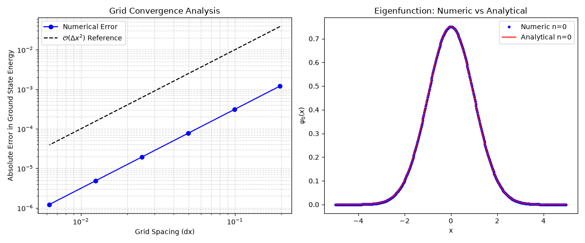

# Numerical Solution of the Quantum Harmonic Oscillator

A computational physics project that solves the one-dimensional quantum harmonic oscillator using the finite difference method.

## 1. Overview

The quantum harmonic oscillator is one of the fundamental systems in quantum mechanics. This project numerically solves the time-independent Schrödinger equation and compares the calculated results with known analytical solutions.

## 2. Physics

The Hamiltonian of the one-dimensional harmonic oscillator is

\[
\hat{H}=-\frac{1}{2}\frac{d^2}{dx^2}+\frac{x^2}{2}
\]

using natural units where \(m=\hbar=\omega=1\).

The analytical energy eigenvalues are

\[
E_n=n+\frac{1}{2}
\]

## 3. Numerical Method

- The spatial domain is discretised into a finite grid.
- The second derivative is approximated using the finite difference method.
- A tridiagonal Hamiltonian matrix is constructed.
- NumPy's `linalg.eigh()` is used to calculate the eigenvalues and eigenvectors.
- The numerical energy levels are compared with analytical values.

## 4. Validation

The numerical solution is checked through:

- Wavefunction normalisation.
- Energy eigenvalue errors.
- Grid convergence analysis.
- Comparison of the numerical ground-state wavefunction with its analytical form.

## 5. Results

The following figure shows the grid convergence analysis and the comparison between numerical and analytical ground-state wavefunctions.



## 6. Requirements

- Python 3
- NumPy
- Matplotlib

## 7. How to Run

Clone this repository and run:

```bash
python qho.py
```

## 8. Limitations

The calculation uses a finite spatial domain and a finite grid. The wavefunction is assumed to vanish at the boundaries, approximating the infinite-domain problem. Numerical accuracy depends on the grid spacing and domain size.

---

**Author:** Manoj  
**Institution:** IISER Tirupati  
**Programme:** BS-MS, Second Year
